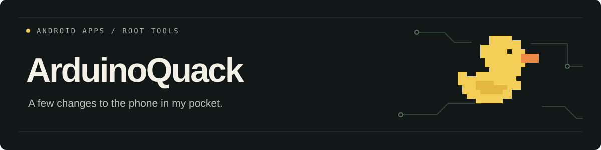

I make apps and modules for rooted Android phones, mostly Samsung. These started with things I wanted to change on my own phone.

### My apps

| Project | What it does | |
| :--- | :--- | :--- |
| **[Icon Match](https://github.com/ArduinoQuack/Icon-Match)** | Match every app icon to OneGlass, including new installs. | [Download](https://github.com/ArduinoQuack/Icon-Match/releases) |
| **[OneTint](https://github.com/ArduinoQuack/OneTint)** | Change the colors of Samsung Keyboard, Quick Panel and volume. | [Download](https://github.com/ArduinoQuack/OneTint/releases) |
| **[MetroBridge](https://github.com/ArduinoQuack/MetroBridge)** | Control MetroList with Gemini. Play playlists and queue songs by voice. | [Download](https://github.com/ArduinoQuack/MetroBridge/releases) |
| **[Internet Tools](https://github.com/ArduinoQuack/Internet-Tools)** | Add uBlock Origin and privacy controls to Samsung Internet. | [Download](https://github.com/ArduinoQuack/Internet-Tools/releases) |
| **[CTS Share Restore](https://github.com/ArduinoQuack/CTS-Share-Restore)** | Bring the share button back to Circle to Search. | [Download](https://github.com/ArduinoQuack/CTS-Share-Restore/releases) |

Root requirements and setup instructions are in each repo. If something breaks, open an issue there.
